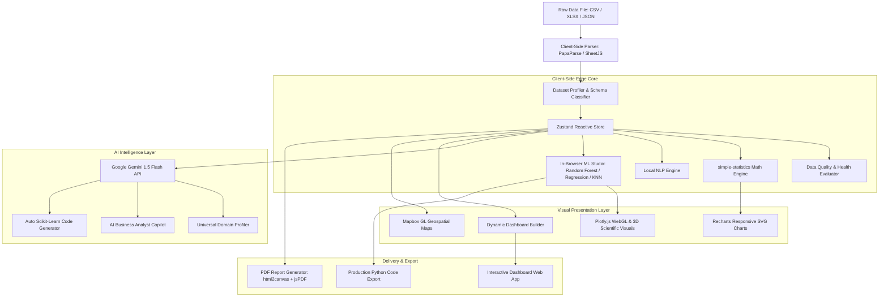

# 🚀 DVAN.AI — Autonomous Data Intelligence & In-Browser ML Studio

<div align="center">

[](https://dvan-ai.vercel.app)
[](https://github.com/2KRISHNAYADAV/DVAN.AI)
[](https://www.typescriptlang.org/)
[](https://reactjs.org/)
[](https://vitejs.dev/)
[](https://tailwindcss.com/)
[](https://ai.google.dev/)
[](https://supabase.com/)

**An enterprise-grade, privacy-first AI platform transforming raw data into predictive machine learning models, interactive visual intelligence, and strategic business decisions — directly in your browser.**

[Explore Live Demo](https://dvan-ai.vercel.app) • [Architecture](#-system-architecture) • [Deep Tech Core](#-what-makes-dvanai-the-best-in-deep-tech) • [Modules](#-core-capabilities--modules) • [Quick Start](#-quick-start)

</div>

---

## 🌟 Overview

**DVAN.AI** bridges the gap between raw data spreadsheets and complex data science pipelines. While traditional BI platforms (Tableau, PowerBI) require heavy server backends and manual dashboard engineering, and Python Jupyter notebooks require programming knowledge, **DVAN.AI delivers a full-stack, zero-setup, no-code data science workspace powered by in-browser edge computing and Large Language Models (LLMs)**.

Upload any dataset (`.csv`, `.xlsx`, `.json`), and DVAN.AI automatically:
1. **Profiles & Grades Data Quality** with automated statistical inferencing.
2. **Recommends Visualizations & KPIs** using heuristic classification.
3. **Trains Machine Learning Models In-Browser** (Random Forest, Linear Regression, KNN) with zero data leaving your machine.
4. **Executes Autonomous Business Analysis** with 18+ enterprise modules (Root Cause, What-If Simulation, Action Plans, Executive Briefings).
5. **Generates Production Scikit-Learn Python Code** and exportable high-resolution PDF executive reports.

---

## 🧠 What Makes DVAN.AI the Best in Deep Tech?

DVAN.AI is engineered on a modern **Edge ML + Generative AI Hybrid Architecture**. Here is the deep technical foundation that puts DVAN.AI miles ahead of conventional data tools:

```
┌────────────────────────────────────────────────────────────────────────────────────────┐
│                                    DVAN.AI PLATFORM                                    │
├───────────────────────────────┬───────────────────────────────────┬────────────────────┤
│      1. CLIENT EDGE ML        │        2. GENERATIVE AI ENGINE     │  3. ADVANCED MATH  │
│  • In-browser Random Forest   │  • Google Gemini 1.5 Flash LLM    │  • Simple Stats    │
│  • Multivariate Linear Regr.  │  • Universal Dataset Profiling    │  • Pearson Matrix  │
│  • KNN Classification         │  • Autonomous AI Business Analyst │  • Outlier IQR     │
│  • Zero-latency local compute │  • Automated Python code exporter │  • Hypothesis Test │
├───────────────────────────────┼───────────────────────────────────┼────────────────────┤
│     4. LOCAL NLP ENGINE       │      5. DUAL GRAPHICS PIPELINE    │  6. REACTIVE STATE │
│  • Client-side tokenization   │  • Plotly.js (Scientific & 3D)    │  • Zustand Stores  │
│  • Rule-based sentiment score │  • Recharts (Fluid SVG Dashboards)│  • Non-destructive │
│  • Stopword & n-gram filtering│  • Mapbox GL (Geospatial Mapping) │  • DAG snapshots   │
└───────────────────────────────┴───────────────────────────────────┴────────────────────┘
```

### 1. In-Browser Client-Side Machine Learning (Zero-Latency Edge ML)
* **Packages Used**: `ml-random-forest`, `ml-regression-multivariate-linear`, `ml-knn`
* **Deep Tech Value**: Instead of uploading sensitive business data to external cloud servers, DVAN.AI executes true machine learning training routines (matrix multiplications, decision splits, nearest-neighbor vector clustering) **directly inside the client's browser JavaScript engine**.
* **Why it makes DVAN.AI superior**:
  * **100% Data Privacy & Security**: Sensitive customer records, financial figures, and healthcare data never leave the user's browser.
  * **Zero Cloud Latency**: Instant model training and evaluation (Train/Test 80/20 split, MAE, MSE, RMSE, $R^2$, Confusion Matrix) without waiting on API queues or compute cluster provisioning.
  * **Export to Scikit-Learn**: Once trained visually, DVAN.AI compiles the parameters into clean, copy-pasteable Python code ready for cloud production pipelines.

### 2. Autonomous LLM Agent & Universal Profiling
* **Packages Used**: `@google/generative-ai` (Gemini 1.5 Flash)
* **Deep Tech Value**: A high-efficiency multimodal LLM layer embedded directly into the analytical loop.
* **Why it makes DVAN.AI superior**:
  * **Universal Semantic Dataset Profiler**: Reads schema metadata and sample distributions to classify domain semantics (e.g., E-Commerce, Healthcare, IoT, SaaS, Supply Chain), identifying target metrics vs dimensions automatically.
  * **AI Business Analyst Copilot**: Understands contextual corporate goals, detects operational bottlenecks, formulates root-cause hypotheses, and devises prioritized action items.
  * **Self-Healing Insight Engine**: Automatically translates complex statistical correlations into plain English executive takeaways.

### 3. Local NLP (Natural Language Processing) Engine
* **Internal Engine**: `src/lib/nlpEngine.ts`
* **Deep Tech Value**: Custom lightweight NLP pipeline built without server dependencies.
* **Why it makes DVAN.AI superior**:
  * Employs heuristic text validation (distinguishing freeform text from categorical codes or booleans), stop-word pruning, lexical sentiment polarity scoring, and n-gram keyword extraction at lightning speed.

### 4. Mathematical & Statistical Inference Engine
* **Packages Used**: `simple-statistics`
* **Deep Tech Value**: Production-grade mathematical routines executed at runtime over arbitrary schemas.
* **Why it makes DVAN.AI superior**:
  * Calculates mean, median, standard deviation, interquartile range (IQR), skewness, and Pearson sample correlation coefficients in real time.
  * Powers confidence interval calculations, single/two-sample hypothesis testing, and residual diagnostics.

### 5. Dual Visualization Graphics Pipeline
* **Packages Used**: `plotly.js-dist-min`, `react-plotly.js`, `recharts`, `mapbox-gl`
* **Deep Tech Value**: Hybrid rendering engine tailored for both speed and scientific precision.
* **Why it makes DVAN.AI superior**:
  * **Recharts**: Powers fluid, interactive, theme-responsive SVG metric dashboards and KPI trends.
  * **Plotly.js**: Renders multi-dimensional scatter matrices, contour heatmaps, 3D distributions, and regression lines that require hardware-accelerated Canvas/WebGL.
  * **Mapbox GL**: Provides interactive geospatial visual mapping for lat/long geographic clusters.
  * **AI Chart Recommender Engine**: Intelligently inspects data cardinality and column names (Financial, HR, Geospatial, Temporal) to auto-generate the optimal chart types.

### 6. Non-Destructive Reactive DAG Notebook Pipeline
* **Packages Used**: `zustand`, `lodash`, `html2canvas`, `jspdf`
* **Deep Tech Value**: Reactive Directed Acyclic Graph (DAG) state architecture for data manipulation.
* **Why it makes DVAN.AI superior**:
  * Notebook cells (`Exploration` ➔ `Cleaning` ➔ `Analysis` ➔ `ML` ➔ `NLP` ➔ `Visualization`) run on immutable dataset snapshots. Any cell can clean, impute, or filter data without corrupting upstream datasets or global state.
  * One-click PDF report compiler that captures high-DPI canvas renderings and compiles pixel-perfect multi-page executive dossiers.

---

## 🏗️ System Architecture



---

## ⚡ Core Capabilities & Modules

| Module | What It Does | Underlying Tech |
|---|---|---|
| **📊 Dynamic Dashboard** | Auto-generates KPI cards, time-series trends, category distributions, and multidimensional comparison charts. | `Recharts`, `ChartRecommendationEngine`, `Zustand` |
| **🧪 In-Browser ML Studio** | Train regression, classification, and clustering models with train/test splits, real-time metrics ($R^2$, MAE), and confusion matrices. | `ml-random-forest`, `ml-regression-multivariate-linear`, `ml-knn` |
| **📓 No-Code Notebook** | Sequential notebook workspace with modular cells for data exploration, cleaning (imputation/dedup), ML, NLP, and visualizations. | `useNotebookStore`, `Immutability Snapshots` |
| **💼 AI Business Analyst** | 18+ corporate intelligence modules: KPI discovery, root cause analysis, what-if simulations, and action plans. | `Google Gemini 1.5`, `businessAnalystStore` |
| **💬 Natural Language NLP** | Sentiment polarity scoring, keyword extraction, and conversational dataset querying. | `nlpEngine.ts`, `validateTextColumn` |
| **📐 Inferential Statistics** | Hypothesis testing, confidence intervals, correlation matrices, and multivariate regression analysis. | `simple-statistics`, `InferentialAnalysis.tsx` |
| **🗺️ Geospatial Maps** | Renders geospatial distributions and location-based density plots. | `mapbox-gl`, `MapVisualization.tsx` |
| **📄 Executive PDF Reporting** | Generates presentation-ready, high-resolution PDF exports of dashboards and notebook outputs. | `html2canvas`, `jspdf` |

---

## 🛠️ Tech Stack & Libraries

### Frontend Framework & Styling
- **React 18** — High-performance concurrent UI architecture
- **TypeScript** — Strict type safety across all statistical models and schemas
- **Vite (SWC)** — Ultra-fast compile times and optimized bundle builds
- **Tailwind CSS & Tailwind Animate** — Design system with custom dark teal/emerald luxury theme
- **Radix UI (shadcn/ui)** — Accessible, modular primitives (Dialogs, Dropdowns, Tabs, Selects)
- **Lucide React** — Modern iconography

### Data Science, ML & Statistics
- **ml-random-forest** — Browser-based Random Forest classification and regression
- **ml-regression-multivariate-linear** — Multi-variable linear model training
- **ml-knn** — K-Nearest Neighbors classifier
- **simple-statistics** — Rigorous mathematical, inferential, and descriptive statistics
- **papaparse & xlsx** — High-speed streaming client-side CSV & Excel parsing

### Artificial Intelligence & LLM
- **@google/generative-ai** — Google Gemini 1.5 Flash SDK integration
- **Custom Local NLP Engine** — Heuristic sentiment analysis and tokenization

### Visualizations & Mapping
- **Recharts** — Declarative, responsive SVG charting
- **Plotly.js (plotly.js-dist-min & react-plotly.js)** — Hardware-accelerated 2D/3D scientific charts
- **Mapbox GL** — WebGL-powered interactive mapping

### Backend, State & Auth
- **Zustand** — Fast, un-opinionated reactive state stores
- **@tanstack/react-query** — Server state synchronization
- **Supabase (@supabase/supabase-js)** — Authentication, cloud persistence, and user security

---

## 🚀 Quick Start

### Prerequisites
- **Node.js**: v18.0.0 or higher
- **npm** or **bun** or **yarn**
- *(Optional)* [Google Gemini API Key](https://aistudio.google.com/) for cloud AI features

### Installation

1. **Clone the repository**:
   ```bash
   git clone https://github.com/2KRISHNAYADAV/DVAN.AI.git
   cd DVAN.AI
   ```

2. **Install dependencies**:
   ```bash
   npm install
   ```

3. **Configure Environment Variables**:
   Create a `.env.local` file in the root directory:
   ```env
   # Google Gemini API Key for AI Insights & Business Analyst Copilot
   VITE_GEMINI_API_KEY=your_gemini_api_key_here

   # (Optional) Mapbox Access Token for Geospatial Maps
   VITE_MAPBOX_TOKEN=your_mapbox_token_here

   # (Optional) Supabase Credentials
   VITE_SUPABASE_URL=your_supabase_url_here
   VITE_SUPABASE_ANON_KEY=your_supabase_anon_key_here
   ```

4. **Start the local development server**:
   ```bash
   npm run dev
   ```
   Open [http://localhost:5173](http://localhost:5173) in your browser.

5. **Build for Production**:
   ```bash
   npm run build
   ```

---

## 🚢 Deployment Workflow

This project is connected with continuous integration on **Vercel**. Any push to the `main` branch automatically triggers a deployment:

```bash
git add .
git commit -m "feat: enhance deep tech analytics modules"
git push origin main
```

Within 1–2 minutes, updates reflect live at:
🔗 **[https://dvan-ai.vercel.app](https://dvan-ai.vercel.app)**

---

## 👨‍💻 Founder & Engineer

<div align="center">

**Krishna Yadav**  
*Founder & Full-Stack AI Engineer*

[](https://github.com/2KRISHNAYADAV)
[](https://linkedin.com)
[](https://dvan-ai.vercel.app/portfolio)
[](https://datshdattashodhini.vercel.app/)

*"Democratizing enterprise data science and machine learning through accessible, zero-code, privacy-preserving visual interfaces."*

</div>

---

## 📄 License

This project is licensed under the **MIT License** — feel free to explore, innovate, and build upon it!
